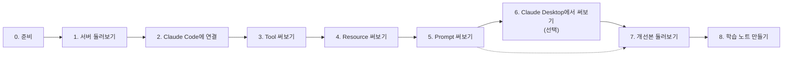

# MCP 입문: 직접 써보며 배우는 MCP 서버

MCP 서버를 한 번도 만들어본 적 없는 개발자를 위한 학습 세트입니다.
이미 완성된 작은 MCP 서버를 Claude Code에 연결해서 **직접 써보고, MCP 서버 쪽 기록을 보면서** MCP의 기본 개념을 익힙니다.

진행은 Claude Code 안의 AI 튜터 **우아한 MCP 코치**가 맡습니다. 한 단계씩 같이 해봅니다.

> **이 학습의 핵심은 여러분의 질문입니다.** 이상하거나 궁금한 게 생기면 그때그때 코치에게 물어보세요. 주제에서 벗어나도 괜찮습니다.
> 학습이 끝나면 오늘 배운 것과 내가 했던 질문을 담은 **학습 노트**가 한 장 남습니다.

## 이 학습을 마치면

- MCP 서버가 제공하는 세 가지 기능(**Tool, Resource, Prompt**)이 무엇이고 어떻게 다른지 설명할 수 있습니다.
- 학습자, Claude Code, 모델, MCP 서버가 각각 무슨 일을 하는지 구분할 수 있습니다.
- 같은 MCP 서버를 Claude Code와 Claude Desktop에서 써보고 비교합니다.
- MCP 서버를 설계할 때 **"이 기능은 Tool인가, Resource인가, Prompt인가"** 를 판단하는 자기 기준을 갖게 됩니다.

## 대상

- MCP를 써본 적은 없지만 직접 만들어보고 싶은 개발자
- Python을 몰라도 괜찮습니다. 서버 코드는 80줄 남짓이고, 튜터가 읽는 법을 같이 안내합니다.

## 예상 시간

1시간 내외

## 준비물

| | 필수 여부 | 비고 |
|---|---|---|
| [Claude Code](https://docs.claude.com/en/docs/claude-code) | 필수 | AI 튜터가 있는 곳이자, MCP 서버를 처음 연결해볼 AI 앱 |
| [Claude Desktop](https://claude.ai/download) | 권장 | 같은 MCP 서버를 연결해 비교해볼 두 번째 AI 앱 |
| [uv](https://docs.astral.sh/uv/) | 필수 | Python과 패키지를 알아서 설치해주는 도구. Python을 따로 설치할 필요가 없습니다 |

---

## 시작하기

> 현재 macOS 기준으로 확인한 학습 세트입니다.

### 1. uv 설치

```bash
curl -LsSf https://astral.sh/uv/install.sh | sh
```

설치가 끝나면 **터미널을 새로 열고** `uv --version`으로 확인합니다.

### 2. 서버가 동작하는지 확인

```bash
cd server
uv run smoke_test.py
```

처음 실행할 때 Python과 필요한 패키지가 자동으로 설치됩니다. 마지막에 아래 문장이 보이면 성공입니다.

```
모두 정상입니다. calls.log 마지막에 기록이 3줄 추가됐는지 확인해보세요.
```

### 3. AI 튜터와 시작

이 폴더(`mcp-starter/`)로 돌아와서 Claude Code를 실행하고, 이렇게 말하면 됩니다.

```bash
cd ..
claude
```

```
시작하자
```

서버를 Claude Code와 Claude Desktop에 연결하는 방법은 튜터가 단계마다 안내합니다.
중간에 세션이 끊겨도 `claude --continue`로 다시 열고 **"이어서 하자"** 라고 하면 됩니다. `/tutor`로 튜터를 직접 불러도 됩니다.

---

## 학습 흐름



이 MCP 서버는 잘 동작하지만 **일부러 고치지 않은 부분**이 있습니다. 써보면서 "어, 이상한데?" 싶으면 코치에게 말해주세요.
더 잘 만든 버전(`improved/`)은 7단계에서 함께 봅니다.

---

## 폴더 구성

```
mcp-starter/
├── README.md      지금 이 문서
├── AGENTS.md      AI 튜터 지침
├── CLAUDE.md      Claude Code가 AGENTS.md를 읽게 하는 연결 파일
├── server/        학습에 쓰는 MCP 서버. 완성돼 있고 잘 동작함
├── improved/      7단계에서 함께 볼 개선 버전
├── notes/         8단계에서 만들어지는 나의 학습 노트 (git에는 올라가지 않음)
└── .claude/       튜터의 진행 장치 (단계별 대본, 용어집, 진행 기록, 훅)
```

### 튜터가 쓰는 훅에 대해

이 폴더에서 Claude Code를 처음 열면, 폴더를 신뢰할지 묻습니다. 신뢰하면 `.claude/settings.json`에 있는 훅 두 개가 동작합니다.

- **세션 시작 훅**: 세션을 다시 열었을 때 어디까지 진행했는지 튜터에게 알려줍니다.
- **도구 사용 전 훅**: 7단계 전에는 튜터(AI)가 `improved/` 폴더를 직접 여는 것을 일부 제한합니다. 완전한 차단은 아니고, 학습자가 직접 여는 것은 막지 않습니다.

두 훅 모두 `.claude/skills/tutor/scripts/progress.py`를 실행합니다. 진행 기록과 학습 중 남긴 질문은 `.claude/progress.json`에만 저장되고, 외부로 아무것도 보내지 않습니다.

## 레퍼런스

- [MCP Specification 2026-07-28](https://modelcontextprotocol.io/specification/2026-07-28) (최신판은 [`latest`](https://modelcontextprotocol.io/specification/latest))
- [MCP Python SDK](https://github.com/modelcontextprotocol/python-sdk) (이 학습 세트는 `mcp` 2.2.0 기준)
- 개념 설명은 2026-07-28 스펙을 기준으로 하지만, 이 예제의 실제 통신 버전은 다를 수 있습니다 (smoke test에 표시되는 프로토콜 버전)
